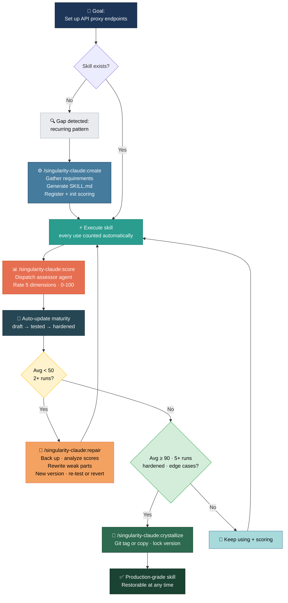
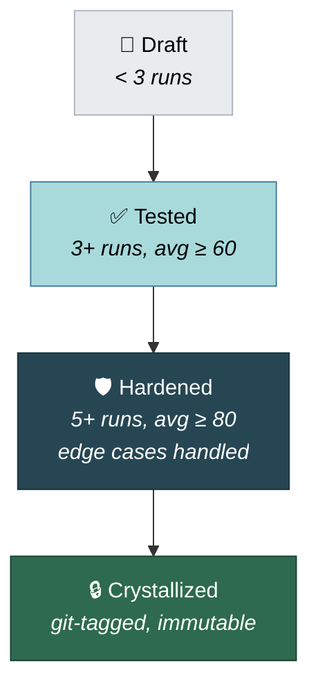

<p align="center">
  <h1 align="center">singularity-claude</h1>
  <p align="center">
    <strong>Skills that evolve themselves.</strong>
    <br />
    A self-evolving skill engine for Claude Code — create, score, repair, and crystallize skills through autonomous recursive improvement loops.
  </p>
  <p align="center">
    <a href="https://opensource.org/licenses/MIT"></a>
    <a href="#installation"></a>
    
    
  </p>
</p>

---

## The Problem

Claude Code skills are **static**. You write them once, and they stay exactly as they are — even when they fail, produce subpar output, or encounter new edge cases. There's no feedback loop, no way to know which skills are working well, and no mechanism to improve them over time.

You end up with a growing pile of skills where some work great, some are mediocre, and some are silently broken. The only way to fix them is manual review.

## The Solution

**singularity-claude** adds a recursive evolution loop to your skills:



> **Tip:** Click the expand button (↔) on the diagram to see the full interactive flow.

Every time a tracked skill runs, a hook counts it, whether Claude invoked it or you typed its command. You score the runs that matter. A low average leads to a repair suggestion; a repair backs up the skill first and reverts if the new version does not do better. A high average over enough runs leads to crystallization, a version you can always restore. Every step is logged.

**No external dependencies.** No SmythOS, no OpenTelemetry collector, no Docker. Pure Claude Code.

## What's Inside

### Skills (7)

Plugin skills are always invoked as `/<plugin>:<skill>`, so every command starts with `singularity-claude:`.

| Command | Who starts it | Purpose |
|---------|---------------|---------|
| `/singularity-claude:create` | you or Claude | Build a new skill and start tracking it |
| `/singularity-claude:score <skill>` | you or Claude | Rate a run on a 5-part rubric (0-100) |
| `/singularity-claude:review <skill>` | you | Health report and next step |
| `/singularity-claude:repair <skill>` | you | Fix a low-scoring skill, with backup and revert |
| `/singularity-claude:crystallize <skill>` | you | Lock a proven version |
| `/singularity-claude:dashboard` | you | All tracked skills in one table |
| `using-singularity` | Claude, when relevant | Explains the engine and the commands |

### Agents (2)

| Agent | Model | Purpose |
|-------|-------|---------|
| **skill-assessor** | Haiku | Fast, cheap automated scoring against the rubric |
| **gap-detector** | Haiku | Analyzes failed tasks to find missing skill capabilities |

### Scripts and hooks

| File | Purpose |
|------|---------|
| `scripts/score-manager.sh` | Scores, versions and the registry. The only writer of `registry.json` |
| `scripts/telemetry-writer.sh` | Structured execution log per skill |
| `hooks/log-use` | Counts every run of a tracked skill (`PostToolUse` on the Skill tool, `UserPromptExpansion` for typed commands) |
| `hooks/session-start` | Creates the data folder; reports skills to repair or crystallize, and prints nothing otherwise |

## Installation

### From GitHub

> **Requires** [Claude Code](https://docs.anthropic.com/en/docs/claude-code) CLI

Inside a Claude Code session (2.1.275 or later), run:

```
/plugin install singularity-claude --marketplace Shmayro/singularity-claude
```

On older versions, add the marketplace first:

```
/plugin marketplace add Shmayro/singularity-claude
/plugin install singularity-claude
```

### From npm

```bash
npm install -g singularity-claude
```

Then inside a Claude Code session:

```
/plugin marketplace add $(npm root -g)/singularity-claude
/plugin install singularity-claude
```

### From source

```bash
git clone https://github.com/shmayro/singularity-claude.git
cd singularity-claude
```

Then inside a Claude Code session:

```
/plugin marketplace add .
/plugin install singularity-claude
```

## Quick Start

```
# 1. Create your first skill
/singularity-claude:create

# 2. Use it on real work. Each use is counted automatically.

# 3. Score a run that matters
/singularity-claude:score my-skill

# 4. See where all your skills stand
/singularity-claude:dashboard
```

Already have skills in `~/.claude/skills/`? Use one, then run `/singularity-claude:score my-existing-skill`: it offers to start tracking it, no need to recreate it.

## How It Works

### The Evolution Loop

**1. Create.** `/singularity-claude:create` asks what the skill should do and when, checks for overlap with existing skills, writes the SKILL.md, registers it and scores a first test run. If Anthropic's `skill-creator` skill is installed, it uses it for the writing and testing.

**2. Use.** A hook counts every run of a tracked skill, so the dashboard shows real usage even for runs nobody scored.

**3. Score.** `/singularity-claude:score <skill>` dispatches a Haiku assessor agent that rates a run on 5 parts:

| Dimension | What It Measures |
|-----------|-----------------|
| **Correctness** (0-20) | Did it achieve the goal? |
| **Completeness** (0-20) | Were all requirements addressed? |
| **Edge Cases** (0-20) | Did it handle unusual inputs? |
| **Efficiency** (0-20) | Was the approach direct and minimal? |
| **Reusability** (0-20) | Could the output be reused? |

**4. Repair.** When the average drops below 50 (configurable), the session start reports it and suggests `/singularity-claude:repair <skill>`. The repair reads the score history and telemetry, backs up the current version, rewrites the weak parts as a new version, reruns the failing cases and reverts if they do not score better.

**5. Harden.** Edge cases met in scored runs are recorded. Skills with more edge cases and higher scores move up the maturity levels.

**6. Crystallize.** At 90+ average over 5+ scored runs with edge cases handled, `/singularity-claude:crystallize <skill>` saves the version with a git tag (or a copy if `~/.claude/skills` is not a git repository). Later edits become a new version; the crystallized one stays restorable.

### Maturity Progression



### When Claude suggests a new skill

The `using-singularity` skill loads when you talk about skills or keep repeating the same multi-step procedure. Claude then suggests `/singularity-claude:create`. Nothing is injected into every session: the session-start hook only speaks when a skill needs repair or is ready to crystallize.

## Data Storage

All data is local. Nothing leaves your machine.

```
~/.claude/singularity/
├── scores/          # Score history per skill and version (JSON)
├── telemetry/       # One entry per use, score, repair (JSON)
├── backups/         # Skill copies taken before each repair
├── crystallized/    # Locked versions (when ~/.claude/skills is not a git repo)
├── registry.json    # All tracked skills, written only by score-manager.sh
└── config.json      # Thresholds and preferences
```

## Configuration

Edit `~/.claude/singularity/config.json`:

```json
{
  "autoRepairThreshold": 50,
  "crystallizationThreshold": 90,
  "crystallizationMinExecutions": 5,
  "scoringMode": "auto"
}
```

| Setting | Default | Description |
|---------|---------|-------------|
| `autoRepairThreshold` | 50 | Average score below this triggers repair suggestion |
| `crystallizationThreshold` | 90 | Average score above this enables crystallization |
| `crystallizationMinExecutions` | 5 | Minimum runs before crystallization is allowed |
| `scoringMode` | `"auto"` | `"auto"` (agent scores), `"manual"` (you score), `"hybrid"` (agent scores, you override) |

## Integration

- Works alongside [superpowers](https://github.com/obra/superpowers) and other Claude Code plugins
- Skills namespaced as `singularity-claude:*` — no conflicts
- Created skills go to `~/.claude/skills/` — the standard Claude Code location, usable by any plugin

## Requirements

- [Claude Code](https://docs.anthropic.com/en/docs/claude-code) CLI
- `jq` (recommended) or Node.js (fallback) for JSON manipulation
- Git (optional, for crystallization via tags)

## Inspired By

[Moltron](https://github.com/adridder/moltron) — a self-evolving skill engine built on SmythOS. singularity-claude takes the same core ideas (scoring, auto-repair, crystallization, hardening) and rebuilds them natively for Claude Code with zero external dependencies.

## Contributing

Contributions welcome! See [CONTRIBUTING.md](.github/CONTRIBUTING.md) for guidelines.

**Ideas for contributions:**
- New scoring rubric dimensions
- Additional maturity metrics
- Platform support (Cursor, Codex, Gemini CLI)
- Skill templates for common patterns

## License

[MIT](LICENSE) — use it however you want.

---

<p align="center">
  <sub>Built with Claude Code. Skills that improve themselves.</sub>
</p>
